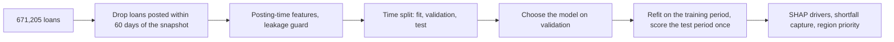

# Kiva Microloan Funding Risk

On posting day, flags the 10% of loans that hold 76% of the unfunded dollars.

| At a glance | |
|---|---|
| **Who decides** | A lending platform or impact funder choosing which new microloans to feature or back with matching funds. |
| **Result** | Reviewing the 10% of new loans ranked riskiest reaches 76% of the $5.8M that went unfunded. |
| **Proof** | 671,205 Kiva loans, scored once on the most recent 129,017; LightGBM at PR-AUC 0.374 against a 4.6% base rate; a test that fails if this page quotes a number the analysis did not produce. |

[](LICENSE)
[](#how-to-run)
[](https://github.com/alvenyuka/Kiva-Loans-Microfinance-Analytics/actions/workflows/ci.yml)


## The problem

On Kiva, microfinance field partners post loans for small borrowers and lenders fund them in small amounts.
About 6% of loans with a known outcome never reach full funding. For the borrower that can mean a missed
planting season or lost stock; for the field partner, a loan it has to cover or cancel. A platform or impact
funder has limited levers (featuring a loan, adding matching funds, working with the partner on terms) and
cannot apply them to every loan. Two questions:

| Question | Short answer |
|---|---|
| Can the loans that will fall short be identified when they are posted? | Yes, well enough to prioritise: the riskiest 10% of new loans hold 76% of the unfunded dollars |
| Does that risk fall hardest on the poorest regions? | No. Across provinces holding 70.6% of settled loans the link is weak, and both the poorest and the least poor fifth are funded less often than the middle |

## How it works



1. **Settled outcomes only.** The funded rate falls from 94% to 16% for loans posted in the snapshot's final
   week, because they were still fundraising. Loans posted within 60 days of the snapshot (3.9%) are excluded.
2. **Posting-time features.** Loan amount and term, repayment schedule, sector, country, borrower gender mix,
   posting month and day, the regional poverty score with a flag for loans that have none, and terms from each
   loan's stated purpose (TF-IDF). Funded time, lender count and funded amount exist only because a loan was
   funded, so a tested guard keeps them out, before and after encoding.
3. **Out-of-time model choice and test.** The training period is split again by date. Four candidates are fitted
   on its earlier part and compared on the latest part, the validation slice: logistic regression, random
   forest, LightGBM, and LightGBM with a time-trend column. The winner is refitted on the whole training period
   and scored once on later loans. Text vocabulary and missing-value medians are fitted only on the loans each
   stage trains on.
4. **Judged on the minority class**, since the funded majority scores well whatever the model does.
5. **Shortfall capture.** Rank test-period loans by predicted risk and measure the funding shortfall (requested
   minus funded, in US dollars) reached by reviewing the riskiest share first (`src/impact.py`).

## Stack

| Layer | Tool |
|---|---|
| Language | Python |
| Data | pandas, NumPy |
| Models | LightGBM, scikit-learn (logistic regression, random forest, TF-IDF) |
| Explainability | SHAP |
| Charts and map | matplotlib, seaborn, Plotly with kaleido |
| Notebook | Jupyter, executed end to end |
| Tests and CI | pytest, GitHub Actions |

The exact Python and package versions of the published run are recorded under `provenance` in
`outputs/results.json`, with the run date, runtime, peak memory and git commit.

## Results

A model that warns, on the day a microloan is posted, that it may never be fully funded, so a platform can step in early. Trained on 671,205 Kiva loans and scored once on the most recent 129,017, reviewing just the 10% it ranks riskiest would reach 76% of the $5.8M that went unfunded. LightGBM with a time trend, PR-AUC 0.374 against a 4.6% base rate, and a test suite that fails if this page quotes a number the analysis did not produce.

- 671,205 loans; 645,083 with a settled outcome, 6.4% of them not fully funded.
- Training period of 516,066 loans; test period of 129,017 loans, 5,957 of them not funded, scored once.
- Four candidate models compared on a validation slice of 103,213 loans before the test set was touched.

| Model | Validation PR-AUC | Test PR-AUC | Test ROC-AUC |
|---|---:|---:|---:|
| **LightGBM + time trend (chosen)** | **0.490** | **0.374** | 0.920 |
| LightGBM | 0.486 | 0.386 | |
| Random forest | 0.395 | 0.286 | |
| Logistic regression | 0.329 | 0.237 | |

PR-AUC is for the at-risk class, whose base rate in the test period is 4.6%. At the default score threshold the
chosen model catches 86% of at-risk loans with 19% precision.

**Stable over time.** A walk-forward test retrains the chosen model before each of four later windows of 64,508
loans and scores the next window. At-risk PR-AUC runs from 0.394 to 0.503, always 4.8 to 14.3 times what random
ranking would score, as the unfunded share falls from 8.3% to 2.9%. The published 0.374, from a single model
scored on the last two windows together, is at the cautious end.

**Weaker for some groups.** Scored within each group by ROC-AUC (which, unlike PR-AUC, does not depend on how
many loans in the group go unfunded), the model ranks worst where risk is highest: 0.850 within all-male loans
against 0.930 within all-female loans, and 0.725 in Pakistan, its weakest country.

**Days to fund.** A days-to-fund regression on funded loans has a mean absolute error of 7.0 days, against 8.1
days for a naive forecast that gives every loan the training-period median.

## Business impact

The test period's loans fell $5,797,550 short of full funding in total. Reviewing loans in order of predicted
risk reaches most of that shortfall early (`src/impact.py`):

| Loans reviewed, riskiest first | Loans | Shortfall reached | Share of shortfall | Unfunded loans reached |
|---|---:|---:|---:|---:|
| 5% | 6,451 | $3,334,700 | 58% | 40% |
| **10%** | **12,902** | **$4,402,525** | **76%** | **62%** |
| 20% | 25,803 | $5,384,850 | 93% | 85% |
| 30% | 38,705 | $5,664,000 | 98% | 95% |

Random review of 10% of loans would reach about 10% of the shortfall; the model's ranking reaches 76%. The
riskiest 10% hold 76% of the unfunded dollars but 62% of the unfunded loans, so the biggest gaps come first. The
loans flagged at the default threshold (20.5% of the test period) account for 93.2% of the shortfall. For a
platform with a fixed budget for featuring or matching funds, this turns an unmanageable queue into a short list.

**Where poverty and risk coincide.** Ranking 154 provinces in 42 countries (each with at least 30 test loans) on
both poverty and the model's average risk puts Moyamba in Sierra Leone (MPI 0.569) and Mopti in Mali (MPI 0.594)
first; 21.4% and 22.6% of their test loans actually went unfunded. Across all 154, the model's province ranking
agrees with the actual unfunded share at a rank correlation of 0.674. Some high-ranked provinces had no unfunded
test loans at all, so the list is a review queue, not an allocation rule.

## Charts


*Loan structure drives the risk. Term and amount rank well ahead of borrower gender mix, sector and country,
which points to terms field partners can adjust. The raw data agrees before any model: the shortest-term sixth
of settled loans go unfunded 0.3% of the time and the longest-term sixth 15.6%, against 6.4% overall; by amount,
0.1% for the smallest sixth and 14.6% for the largest. Loans to all-male borrowers go unfunded 14.5% of the
time, all-female 3.9%.*


*Funding risk is somewhat higher at both ends of the poverty scale, not concentrated on the poorest:*

| Poverty of the borrower's province | Least poor fifth | Second | Middle | Fourth | Poorest fifth |
|---|---:|---:|---:|---:|---:|
| Loans fully funded | 92.1% | 97.1% | 96.2% | 95.8% | 93.0% |

## Data

| Source | Link | Terms | Size | Period | Refresh |
|---|---|---|---:|---|---|
| Data Science for Good: Kiva Crowdfunding | [Kaggle](https://www.kaggle.com/datasets/kiva/data-science-for-good-kiva-crowdfunding) | Kaggle dataset licence | 671,205 loans | snapshot ends 26 Jul 2017 | static |
| Kiva regional Multidimensional Poverty Index and `loan_themes_by_region.csv` | same dataset | same | 50,955 loans matched exactly | same | static |

| Split | Value |
|---|---:|
| Loans with a settled outcome (posted over 60 days before the snapshot) | 645,083 |
| Training period (posted up to 27 Oct 2016) | 516,066 loans |
| of which validation slice (posted after 23 Apr 2016) | 103,213 loans, 9.6% not funded |
| Test period (posted after 27 Oct 2016) | 129,017 loans, 4.6% not funded |
| Loans matched to a regional poverty score | 50,955 (7.6%) |

The CSVs are not committed: put `kiva_loans.csv`, `kiva_mpi_region_locations.csv` and
`loan_themes_by_region.csv` in `data/`.

## Key design decisions

- **The model chosen on validation, not on the test.** Plain LightGBM scores higher on the test period (0.386),
  but choosing it for that reason would turn the test set into a second validation set, so the published
  figure is 0.374.
- **Recent loans excluded rather than counted as unfunded.** Loans still fundraising at the snapshot would have
  looked like failures; the 60-day rule removes 3.9% of loans and the bias with them.
- **A tested leakage guard.** Funded time, lender count and funded amount exist only after funding, so a test
  fails if any reaches the model, before or after encoding.
- **The narrow poverty join kept in the model.** Matching region names directly covers 7.6% of loans; on those,
  across 75 regions, poorer regions were funded slightly more often (correlation 0.303; rank correlation 0.375),
  but that rests on 7.5% of settled loans.
  Kiva's own region link widens coverage to 70.9% of loans across 240 provinces in 47 countries, where the
  straight-line link is weak (correlation 0.081; rank correlation 0.121). Swapping the wider score into the
  model was tested under a rule fixed beforehand (adopt only for a clear gain in validation PR-AUC); it fell
  from 0.4902 to 0.4880, so the model keeps the exact-join score.
- **Ranks, not probabilities.** Calibrating on the validation period, when 9.6% of loans went unfunded,
  over-predicted the test period, when 4.6% did: calibrated scores averaged 7.8% and the Brier score worsened
  from 0.0345 to 0.0371. The review list uses the ranking, which is unaffected.

## Limits

- **Correlational only.** Nothing here shows that a factor causes funding success, and the poverty link is
  measured across provinces, not individual borrowers, through a link Kiva assigned by nearest point.
- **Model choice rests on one validation slice.** The validation slice had a higher unfunded share (9.6%) than
  the test period (4.6%), and the two LightGBM candidates swap order between them. The walk-forward test shows
  the chosen model's score holds across later windows; it does not re-run the choice in each window.
- **Weaker where risk is highest.** A score that ranks all-male loans and some countries less well needs
  checking before it decides who gets help.
- **Scores rank, they are not probabilities.** Balanced class weights move every score towards 0.5, so region
  priority uses ranks rather than multiplying scores by poverty.
- **Days-to-fund is truncated.** Recent loans still raising money at the snapshot have no days-to-fund value,
  so the test target leans towards quick fundraising.
- **Residual censoring.** A few loans older than 60 days at the snapshot may still have been fundraising.
- **Shortfall is not loss.** It measures money borrowers did not receive through Kiva, not a financial loss to
  the platform.

## Project structure

```
Kiva_Loans_Microfinance_Analytics.ipynb   the analysis, organised around the two questions, executed end to end
src/features.py                           leakage guard, funding target, gender parsing
src/impact.py                             funding-shortfall capture
outputs/results.json                      every headline number, package versions, git commit
tests/                                    tests for the logic the results rest on, and for this README
figs/                                     shortfall capture, precision-recall curve, SHAP drivers and direction,
                                          calibration, funding-by-province map
docs/METHODOLOGY.md                       full method, every result, limitations
```

The notebook is written to be followed and recreated step by step, in the Prepare Data, Split, Build Model and
Communicate Results format of the WorldQuant University Applied Data Science Lab: a setup guide, a table of
checkpoints, a `wrangle` function for each CSV file, each concept explained where it first appears, and checks
that stop the run at any step that goes wrong.

## How to run

```bash
pip install -r requirements.txt
python -m pytest              # no dataset needed
# put kiva_loans.csv, kiva_mpi_region_locations.csv and loan_themes_by_region.csv in ./data
jupyter nbconvert --to notebook --execute Kiva_Loans_Microfinance_Analytics.ipynb --output Kiva_Loans_Microfinance_Analytics.ipynb --ExecutePreprocessor.timeout=3600
```

The last recorded run took 24 minutes and peaked at 4.4 GB of memory; on a machine short of memory it has taken
much longer.

## Skills demonstrated

- Out-of-time model selection on a validation slice, with a single scoring of the test period: the notebook
- Leakage control enforced by tests: `src/features.py`, `tests/`
- Class-imbalance evaluation with PR-AUC and walk-forward retraining: `outputs/results.json`
- Gradient boosting and SHAP explanation of what drives risk: the notebook, `figs/`
- Text features from loan descriptions with TF-IDF: the notebook
- Joining a poverty index across mismatched geographies, and testing it as a challenger: the notebook
- Turning a ranking into a review policy priced in dollars: `src/impact.py`
- A README whose every number is checked against the results file: `tests/test_readme_numbers.py`

## License

MIT. See [`LICENSE`](LICENSE). Data: [Data Science for Good: Kiva Crowdfunding](https://www.kaggle.com/datasets/kiva/data-science-for-good-kiva-crowdfunding) (Kaggle).

Alven Yuka · [LinkedIn](https://www.linkedin.com/in/alven-yuka-610b78174/) · [Email](mailto:alvenyuka2@gmail.com)
