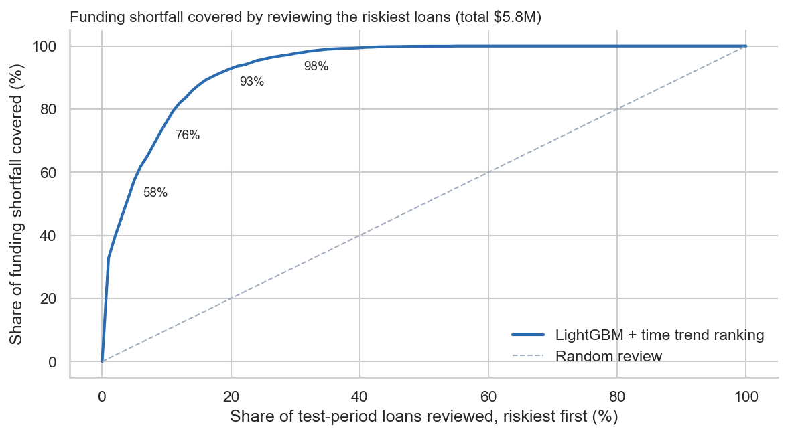
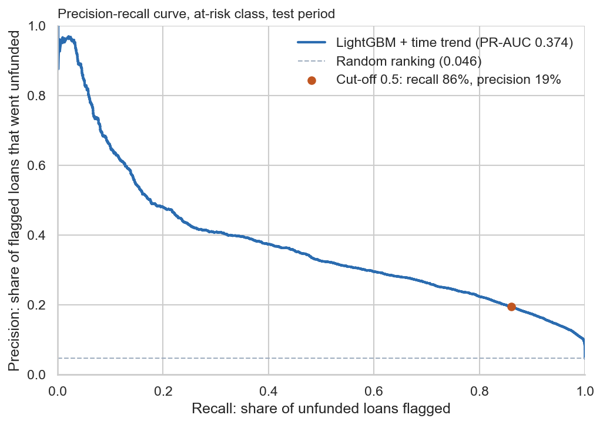
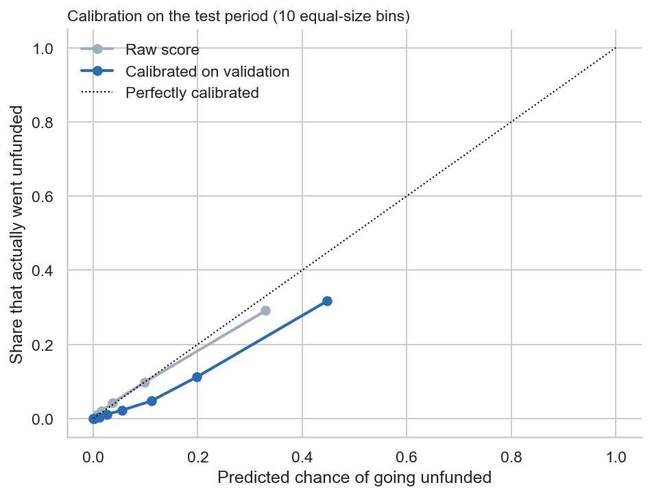
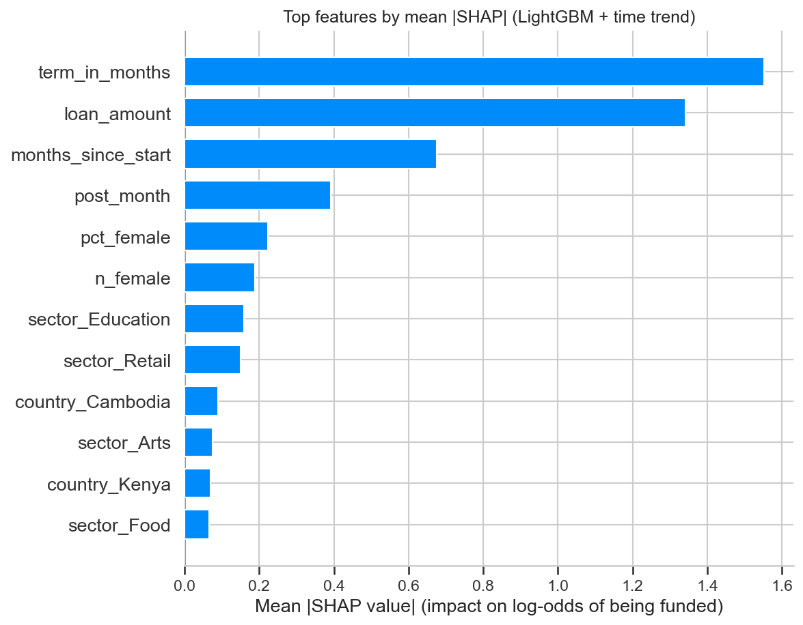
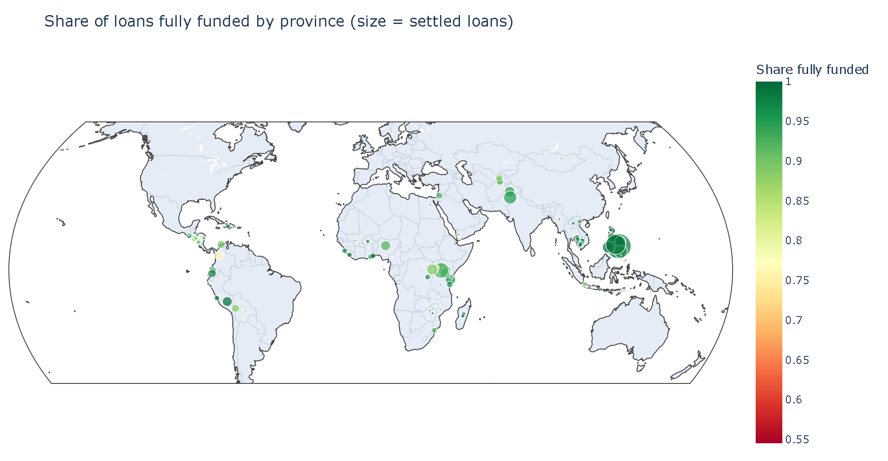

# Kiva Microloan Funding Risk

A model that flags, on the day a microloan is posted on Kiva, the loans most likely to go unfunded, so a lender or funder knows where to look first.

[](LICENSE)
[](#how-to-run)
[](https://github.com/alvenyuka/Kiva-Loans-Microfinance-Analytics/actions/workflows/ci.yml)



## What this project does

Kiva is a crowdfunding site for microloans. A field partner in a developing country posts a small loan for a
borrower, say a farmer who needs money for seed, and members of the public chip in a few dollars each until the
loan is funded. Some loans never reach their target. I call those "unfunded": the loan closed with less money
raised than it asked for. The borrower may then miss a planting season, and the field partner has to cover the gap
or cancel. A platform or impact funder can help a few loans (feature them, add matching funds, talk to the partner
about the terms) but not all of them. So the question is: which new loans will probably fall short, and can that be
known when the loan is posted?

The data is the public Kiva dataset on Kaggle: 671,205 loans posted up to 26 Jul 2017. Details are in "Data".

## Results

I trained on the earlier loans and scored the most recent 129,017, which the model never saw while I was building
it. All figures are in `outputs/results.json`.

- **The riskiest 10% of loans hold 76% of the unfunded dollars.** In that test period, loans fell $5,797,550 short
  of what they asked for. Ranking loans by predicted risk and reviewing the top 10% (12,902 loans) reaches
  $4,402,525 of it, and 62% of the loans that went unfunded. Reviewing 10% of loans at random would reach about 10%.
- **The model's PR-AUC is 0.374, against a base rate of 4.6%.** PR-AUC is a score from 0 to 1 for how well a model
  puts the loans that went unfunded near the top of its ranking. Only 4.6% of test loans went unfunded, so a model
  ranking at random scores about 0.046. This one scores about eight times that. The terms are defined in "How I
  built it".
- **At the default cut-off of 0.5, it catches 86% of unfunded loans, and 19.4% of the loans it flags really go
  unfunded.** That is a review queue, not a verdict. The flagged loans are 26,388 loans (20.45% of the test set)
  and hold 93.2% of the shortfall.
- **A second model predicts days to fund.** For loans that did get funded, it is off by 7.04 days on average,
  against 8.08 days for a guess of the training-period median.

| Loans reviewed, riskiest first | Loans | Shortfall reached | Share of shortfall | Unfunded loans reached |
|---|---:|---:|---:|---:|
| 5% | 6,451 | $3,334,700 | 58% | 40% |
| **10%** | **12,902** | **$4,402,525** | **76%** | **62%** |
| 20% | 25,803 | $5,384,850 | 93% | 85% |
| 30% | 38,705 | $5,664,000 | 98% | 95% |

Shortfall is the requested amount minus the amount funded, per loan, in US dollars. The table comes from
`src/impact.py`, run on the test period. It measures money borrowers did not receive through Kiva, not a loss to
the platform.

| Model | Validation PR-AUC | Test PR-AUC |
|---|---:|---:|
| **LightGBM + time trend (chosen)** | **0.490** | **0.374** |
| LightGBM | 0.486 | 0.386 |
| Random forest | 0.395 | 0.286 |
| Logistic regression | 0.329 | 0.237 |

Validation PR-AUC is the score on a slice of the training period held back to choose between models, and test
PR-AUC is the score on the later loans kept untouched. Logistic regression, random forest and LightGBM are three
standard ways to learn a loan's risk from its features. Logistic regression weights each feature and adds them
up, a random forest averages many decision trees, and LightGBM (step 6) adds trees one at a time.
## How I built it

The steps follow the order of the work; the notebook section for each is in brackets. All of it is in
`Kiva_Loans_Microfinance_Analytics.ipynb`. Each term is defined where it first appears.

1. **Load and clean the data** (Prepare Data, sections 1 and 2). Three CSV files, each read by a `wrangle` function
   so the cleaning lives in one place. `wrangle` reads the loans, parses the borrower genders (many loans are
   group loans), adds the target, and attaches a poverty score to each loan. A loan is "fully funded" when it
   raised at least what it asked for.
2. **Define "at risk"** (section 3). The data is a snapshot, so a loan posted a week before the end may still be
   raising money. Among loans in their first week, only 16% are funded, against 94% for the oldest loans.
   Counting those as failures would be wrong, so I drop loans posted within 60 days of the snapshot (26,122 loans,
   3.9%). Of the 645,083 that remain, 6.4% are unfunded. The **base rate** is the share of loans in a group that
   have the outcome you are looking for: 4.6% of test loans were unfunded.
3. **A baseline** (section 7). A model that gives every loan the same score. It sets the number any real model has
   to beat. **Recall** is the share of all unfunded loans that were flagged. **Precision** is the share of flagged
   loans that really went unfunded. **PR-AUC** is the area under the precision-recall curve: rank loans from
   riskiest to safest and walk down the list, noting precision and recall at each step. A random model scores the
   base rate, so on the validation slice the baseline scores 0.0962.
4. **Features, including a poverty score** (sections 4 to 6, `src/features.py`). Only facts known when a loan is
   posted: amount, term, repayment schedule, sector, country, borrower gender mix, posting month and weekday, words
   from the loan's stated purpose, and the poverty score of its region (the Multidimensional Poverty Index, MPI,
   from 0 to 1, higher is poorer). A guard in `src/features.py` raises an error if a column that only exists after
   funding (funded time, lender count, funded amount) reaches the model.
5. **Split by date** (section 6). Models fit on the earliest 80% of loans by posting date (516,066 loans), and the
   latest 20% (129,017) is the test set. Inside the training period, the last 103,213 loans form a validation
   slice used to choose between models. Text vocabulary and missing-value medians are learned only from the loans
   each stage trains on.
6. **Four models, chosen on validation** (section 8). Logistic regression, random forest, LightGBM (many small
   decision trees, each fixing the errors of the last), and LightGBM with a time-trend column (months since the
   first loan). The last one scored best on validation (0.490). Plain LightGBM scores higher on the test period
   (0.386), but picking it for that reason would make the test set a second validation set, so I kept the choice
   made on validation and report both.
7. **The precision-recall curve and the threshold** (section 9). A **threshold** is the score above which a loan is
   flagged. Moving it trades recall for precision: catching a quarter of unfunded loans comes with 42.9%
   precision, half with 32.6%, three quarters with 24.4%.

   

   *Notice how far the curve stays above the 4.6% base rate. Where to cut is a choice about how many loans a
   team can review.*
8. **Check it over time** (section 9). Walk-forward validation trains on everything before a cut-off, scores the
   next block of loans, then moves the cut-off on. Over four later windows of about 64,508 loans, PR-AUC runs from
   0.394 to 0.503, between 4.8 and 14.3 times the random score as the unfunded share falls from 8.3% to 2.9%.
9. **Calibration** (section 9). A model is calibrated when its scores can be read as probabilities. I tried
   isotonic regression, which learns a staircase from score to probability. It made the Brier score (the average
   squared gap between predicted probability and outcome; lower is better) worse, from 0.0345 to 0.0371, so the
   scores are used as a ranking only.

   

   *The scores rank loans well but are not probabilities, so the review list uses the order, not the values.*
10. **What drives the risk** (section 11). SHAP splits each score into the push from each feature. Loan term and
    loan amount lead, ahead of the time trend and posting month. Short, small loans are funded more often: the
    shortest-term sixth of loans goes unfunded 0.3% of the time, the longest-term sixth 15.6%.

    

    *Term and amount move the score about twice as much as the time trend and far more than country or sector, and
    they are the two a field partner can change.*
11. **Money impact** (section 12, `src/impact.py`). Rank test loans by risk and measure the shortfall reached by
    reviewing the top slices. This gives the table in "Results".
12. **Days to fund** (section 10). A regression on funded loans, which predicts a number rather than a yes or no.
    **MAE** (mean absolute error) is the average gap between prediction and truth, here 7.04 days against 8.08 for
    the median guess.

Does the risk fall hardest on the poorest regions? Mostly no. Matching loan regions to poverty-index provinces
through Kiva's own link reaches 70.9% of loans. By poverty fifth, the share fully funded is 92.1%, 97.1%, 96.2%,
95.8% and 93.0% from least poor to poorest, so risk is somewhat higher at both ends and not concentrated on the
poorest. The notebook also tried the wider poverty score in the model under a rule set beforehand (adopt only if
validation PR-AUC clearly improves). It fell from 0.4902 to 0.4880, so the model keeps the narrower exact-match score.



*Most provinces are funded more than 90% of the time. There is no broad region where funding fails.*

## Problems I hit

- **Recent loans looked like failures.** Charting funded rate by loan age showed 16% funded in the first week and
  94% for the oldest loans, which can only mean loans still raising money. I excluded loans within 60 days of the
  snapshot and tested out of time (commit "Exclude censored loans, test out of time and fit preprocessing on train only").
- **The default PR-AUC scores the wrong class.** `average_precision_score` scores the "funded" class, whose floor
  is about 95%, so it looks excellent whatever the model does. The notebook flips labels and scores to score the
  unfunded class and prints both (funded class 0.9958 against the headline 0.3742).
- **A leakage guard I had only written in prose.** Funded time, lender count and funded amount exist only because
  a loan was funded, and leaking them raises the score instead of raising an error. The guard now runs before and
  after one-hot encoding (turning each category into its own 0/1 column), since encoding renames columns, and is covered by tests (commit "Extract the leakage guard into tested code").
- **Calibration made things worse.** Fitting it on a validation slice where 9.6% of loans went unfunded
  over-predicted a test period where 4.6% did: mean calibrated score 7.8%, Brier 0.0345 to 0.0371. I changed the
  test to check what calibration guarantees (commit "Check what calibration guarantees") and used ranks.
- **The first poverty join reached 7.6% of loans.** Loan regions are towns and the poverty index is by province, so
  an exact match failed for most loans. That is why I added Kiva's own link, and why I tested whether it helped
  the model (it did not). The poverty file also had bad map points: Herat in Afghanistan sat in South-East Asia.
  `find_misplaced` drops points far from the rest of their country and keeps the MPI values (94 points flagged).

## Data

| Source | Terms | Size | Period |
|---|---|---:|---|
| [Data Science for Good: Kiva Crowdfunding](https://www.kaggle.com/datasets/kiva/data-science-for-good-kiva-crowdfunding) on Kaggle: `kiva_loans.csv`, `kiva_mpi_region_locations.csv`, `loan_themes_by_region.csv` | Kaggle's terms for the "Data Science for Good: Kiva Crowdfunding" dataset | 671,205 loans | snapshot ends 26 Jul 2017 |

It is real Kiva data, not simulated. The CSVs are not committed: put them in `data/`. The test period is the 129,017
loans posted after 27 Oct 2016, 4.6% of them unfunded. The exact poverty match covers 50,955 loans (7.6%).

## Limits

- **Correlation only.** Nothing here shows that loan term or amount causes funding failure. The poverty link is
  measured across provinces, not borrowers, through a link Kiva assigned by nearest point.
- **One validation slice picked the model.** Its unfunded share (9.6%) was higher than the test period's (4.6%),
  and the two LightGBM models swap order between them.
- **Weaker where risk is highest.** By ROC-AUC (the chance a random unfunded loan is ranked riskier than a random
  funded one), the model scores 0.850 on all-male loans against 0.930 on all-female loans. Check this before the
  score decides who gets help.
- **Scores rank, they are not probabilities** (see step 9).
- **Days to fund is truncated.** Recent loans still raising money have no value, so the target leans towards fast
  funding.
- **A few loans older than 60 days may still have been fundraising.**
- **The recorded run is from 11 Oct 2026**, 24 minutes and 4.4 GB of memory at peak.

## How to run

The recorded run's Python and package versions are in `outputs/results.json`. Main libraries: pandas, scikit-learn, LightGBM, SHAP.

```bash
pip install -r requirements.txt
python -m pytest              # no dataset needed
# put the three CSV files in ./data, then:
jupyter nbconvert --to notebook --execute Kiva_Loans_Microfinance_Analytics.ipynb --output Kiva_Loans_Microfinance_Analytics.ipynb --ExecutePreprocessor.timeout=3600
```

The notebook writes `outputs/results.json` and the charts in `figs/`. `tests/test_readme_numbers.py` fails if this
page quotes a number that is not in that file.

## Project structure

```
Kiva_Loans_Microfinance_Analytics.ipynb   the analysis, executed end to end
src/features.py                           leakage guard, funding target, gender parsing
src/impact.py                             funding-shortfall capture
outputs/results.json                      every figure above, package versions, git commit
tests/                                    tests for the logic above, and for this README
figs/                                     charts used here
docs/METHODOLOGY.md                       longer method notes
```

## License

MIT. See [`LICENSE`](LICENSE). Data: [Data Science for Good: Kiva Crowdfunding](https://www.kaggle.com/datasets/kiva/data-science-for-good-kiva-crowdfunding) (Kaggle).

Alven Yuka · [LinkedIn](https://www.linkedin.com/in/alven-yuka-610b78174/) · [Email](mailto:alvenyuka2@gmail.com)
